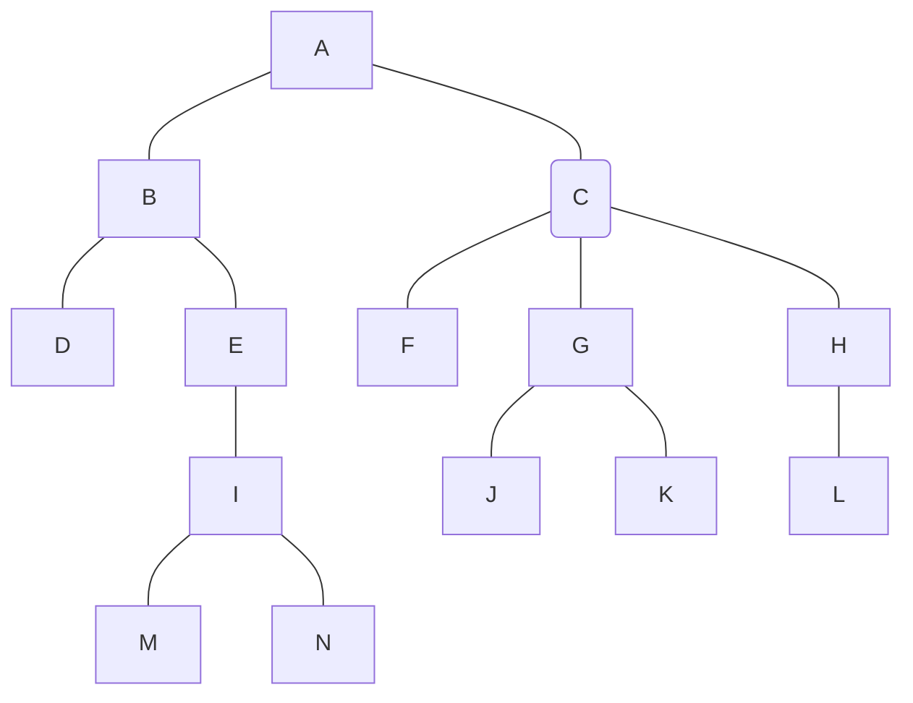

**Fecha de inicio:** 25-11-2024 - Algoritmos I
---
**Tags:** #InProgress    #Algoritmos_I #Ejercicios
---
---
## Descripción de la tarea
Responda las siguientes preguntas para el árbol de la figura:

1. ¿Qué nodos son hojas?
2. ¿Qué nodo es raíz?
3. ¿Cuál es el padre del nodo C?
4. ¿Qué nodos son los hijos de C?
5. ¿Qué nodos son los antecesores de C?
6. ¿Qué nodos son los descendientes de E?
7. ¿Cuáles son los hermanos derechos de D y E?
8. ¿Qué nodos están a izquierda y qué nodos a derecha de G?
9. ¿Cuál es la profundidad del árbol?
10. ¿Cuál es la altura del nodo C?
### Representación del Arbol

## Resolución
1) Nodos Hojas: D, M, N, F, J, K, L
2) Nodo Raíz: A
3) Padre de Nodo C: A
4) Nodos Hijos de C: F, G, H
5) Nodos antecesores de C: A
6) Nodos Descendientes de E: I, M ,N
7) Hermanos Derechos de D y E:
	1) D: E
	2) E: No existe
8) Nodos respecto a G:
	1) Nodos a derecha: H
	2) Nodos a Izquierda: F
9) Profundidad del arbol: 4
10) Altura del Nodo C: 2
## Relaciones
- [[Arboles-AlgoritmosI]]
