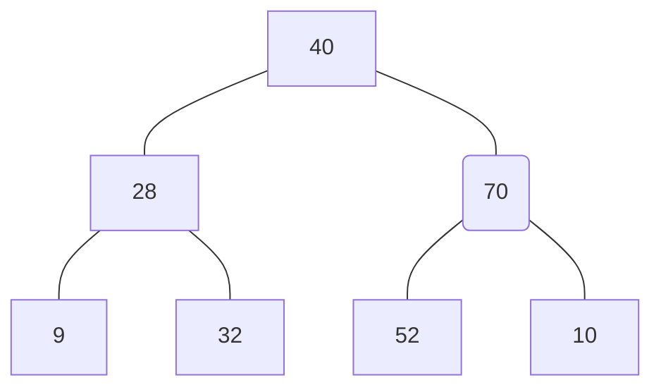

**Fecha de inicio:** 25-11-2024 - Algoritmos I
---
**Tags:** #InProgress    #Algoritmos_I #Ejercicios
---
---
## Descripción de la tarea
1. Indique el resultado del recorrido post-orden
2. Indique el resultado del recorrido en-orden
3. Elabore un algoritmo para el recorrido en-orden

### Representación del Arbol 

## Resolución
1) Recorrido en POST-ORDER: 9, 32, 28, 52, 10, 70, 40
2) Recorrido IN-ORDER:9,28,32,40,52,70,10
3) Algoritmo IN-ORDER:
	``` less
Accion Guia-Ejercicio-5.3.4(Root:Puntero a Nodo) Es
    Ambiente
        Nodo = Registro
            Dato:Numero
            IZQ:Puntero a Nodo
            DER:Puntero a Nodo
        finRegistro
        Procedimiento InOrder (NodoActual:Puntero a Nodo) Es
            Si NodoActual <> NULL Entonces
                InOrder(*NodoActual.IZQ)
                Escribir(*NodoActual.Dato)
                InOrder(*NodoActual.DER)
            FinSi
        finProcedimiento
    finAmbiente
    Proceso
        InOrder(Root)
    finProceso
finAccion
	```
## Relaciones
- [[Arboles-AlgoritmosI]]
- [[Recursividad-Introduccion-AlgoritmosI]]